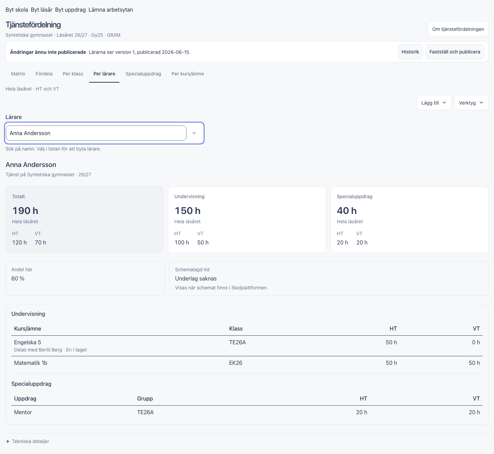
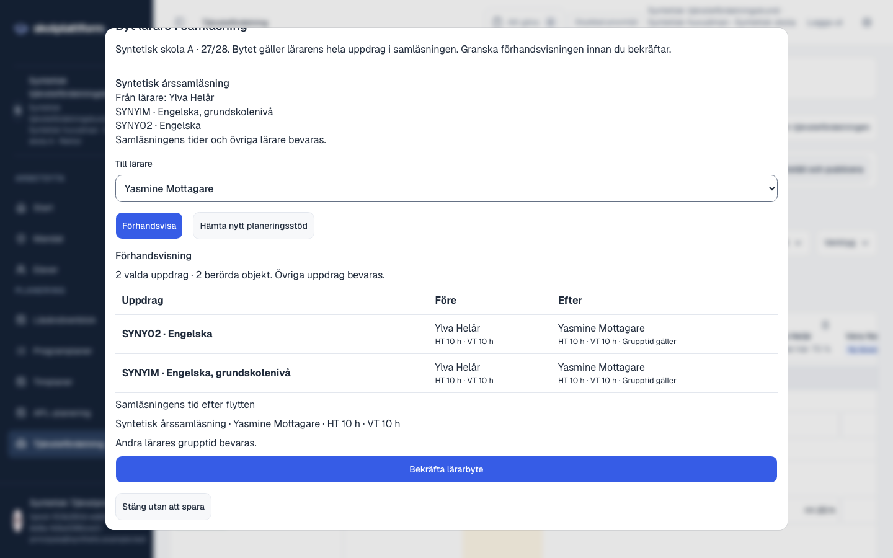

# Uppföljning av dina sex anteckningar — tjänstefördelning

**Layoutuppföljning44:** Ämnesnamnet visas nu en gång med endast koden under. Installerad982444b på3012; UI28/typ/lint/bygge/hälsa PASS. Tidigare leveranser och deras faktiska prov redovisas nedan.

**Senare layoutuppföljning43:** Samläsningsmärket ligger nu bredvid ämnesrubriken på3012 som2d38095.18 riktade UI-prov och bygge/hälsa PASS. De88 faktiska kontrollerna nedan avser föregående6692919.

Leveransen42: genomförd och installerad på [3012](http://127.0.0.1:3012/?vy=tjanst), version **6692919**. Ladda om sidan för att se ändringarna. Nytt användarprov återstår.

| Anteckning | Ändring |
| --- | --- |
| Mindre ”Ny lärare” | Liten blå textmarkör utan stor knappform. Texten finns kvar även för den som inte skiljer färgerna. |
| Mindre ”Samläsning” | Liten färgad etikett. Själva klickytan är fortfarande minst 44 px och fungerar med tangentbord. |
| Samma första klick på bemannade rader | Ett bemannat behov visar först **Byt lärare** eller **Avancerade val**, även vid klick på en tom annan lärarkolumn. Helt obemannat behov med känd tid och aktuellt underlag behåller direkt tilldelning till den klickade läraren. |
| Tydligare Per lärare | Tre kort visar total tid, undervisning och specialuppdrag, med läsår samt HT/VT. Andel och schema ligger separat; undervisning, uppdrag och återkoppling har tydliga avsnitt. Personal-ID ligger under Tekniska detaljer. |
| Sökbart lärarval | Sök på namn och välj i listan. Pilknappar/Enter och pekval fungerar; Escape avbryter. Söktext väljer och sparar inget. Lika namn skiljs åt och valen använder person-ID. |
| Snyggare Planeringsval | Sammanhållen vit kontrollrad med tydliga skol- och läsårsval, samlade årspilar och återgång till aktuellt läsår. Befintliga funktioner och spärrar för osparat arbete är kvar. |

## Så fungerar lärarbytet

Klicka på den nya lärarens cell på ett redan bemannat behov och välj Byt lärare. Finns flera tilldelningar väljer du vilken som ska ersättas. Den klickade läraren förbereds när personen är ett tillåtet mål; en lärare som redan finns på behovet förväljs aldrig som dubblett. Tid, kommentar och radens identitet följer med. Du bekräftar med Spara tjänsteraden.

För samläsning omfattar bytet hela den valda lärarens medlemsmängd i gruppen. Du ser Förhandsvisa före Bekräfta lärarbyte. Andra lärares fristående rader på samma behov ändras inte. Avancerade val öppnar vald vanlig rad eller rätt samläsningsgrupp. Skift-klick/Skift-Enter och inställningen för avancerade val är kvar som genvägar.

## Specialfall som rättats under granskningen

- En vald vanlig tilldelning kunde annars öppna en annan samläsning på samma behov. Valet följer nu exakt vald rad även när två grupper finns på behovet.
- En klickad person som redan hade en annan tilldelning kunde annars förberedas som dubblettmål. Då öppnas i stället lärarvalet med befintliga dubblettspärrar.
- Lärarlistan begränsas av det faktiskt tillgängliga utrymmet så att de nedersta alternativen går att nå i en låg vy.
- Lärarfältets fokusmarkering är samlad runt väljaren.

## Verifiering och återstående arbete

Slutresultat: **298 UI-tester**, **138 personal-/årsprov**, **56 domänprov** och **88/88 faktiska Worker-/OIDC-/databaskontroller** passerade. Typkontroll, lint, appbyggen och handboksbygge passerade. Installerad artefakt är identisk med den faktiskt provade: 1 370 filer. Hälsa och klientfiler fungerar; skyddade API:er nekar anrop utan inloggning. Föregående version 785b4ff är kvar för återgång. [Verifieringsbevis](annotations-42-verification.json) · [Leveransbevis](annotations-42-deployment.json). Proven använder syntetiska uppgifter. Ett minskat webbläsarfönster och telefonemulering provar layouten; ett fysiskt skärmtangentbord har inte provats. Ingen ny kommunanslutning eller ny SS 12000-efterlevnad påstås.

De fem ursprungliga UX-punkterna F02/F04/F05/F07/F08 är fortfarande öppna enligt sina kvarstående delar. Den sökbara väljaren i Per lärare avslutar inte arbetet med en gemensam kandidatväljare i alla redigeringsflöden.

## Bilder från syntetiska komponentprov

[Telefonens staplade översikt](annotations-42-teacher-phone.png) · [Planeringsval på mindre dator](annotations-42-planning-desktop-small.png).

## Samlat lärarbyte med förhandsvisning

Bilden kommer från det isolerade faktiska Worker-/OIDC-/databasprovet, med syntetiska lärare och grupper.
